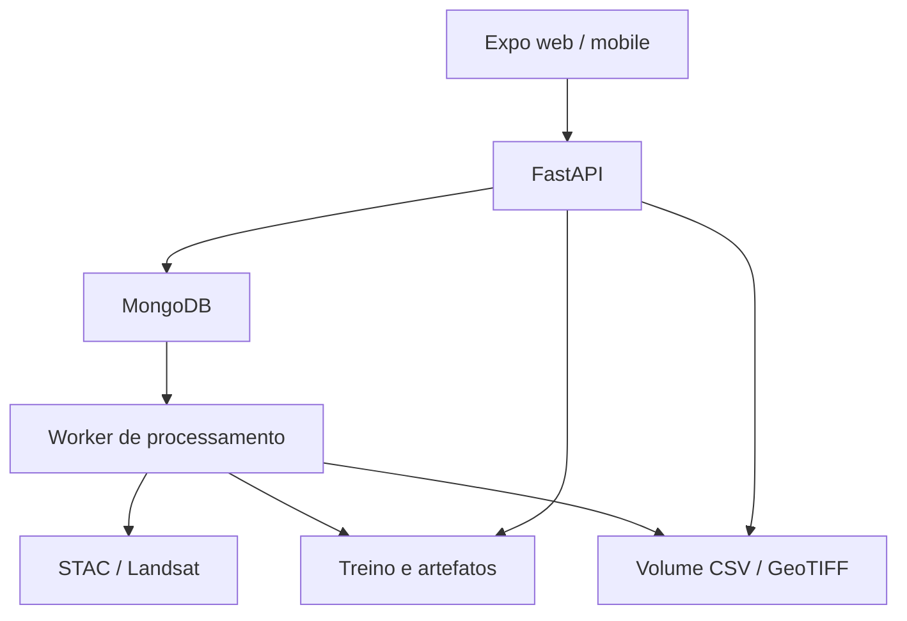

# Arquitetura e decisões

## Fronteiras

Rotas validam entrada e autorização. Serviços fazem I/O e processamento. Models
não dependem de FastAPI ou MongoDB: podem ser executados via CLI e testes.
O worker usa a fila persistida no MongoDB para não executar treinamento durante
uma requisição HTTP. O download simples de GeoTIFF continua síncrono e limitado.

## MongoDB

| Coleção | Índice/finalidade |
| --- | --- |
| users | Email único, hash Argon2, verificação e plano |
| areas | ID único e proprietário; polígonos, notas, data e status |
| keys | Hash único; somente prefixo exibível e revogação |
| usage | _id com proprietário/período; incremento condicional atômico |
| observations | dataset_id + cell_id únicos; geometria 2dsphere |
| datasets | Metadados, fonte, qualidade e referência ao volume |
| jobs | Status, progress, attempts, lease, payload e result |
| models | ID imutável, configuração, métricas, procedência |
| registry | Documento singleton active com model_id publicado |
| predictions | Auditoria resumida (não guarda todas as entradas) |

## Escolhas e limitações

- MongoDB é o único banco. Arquivos grandes usam volume persistente; não há GridFS nesta versão.
- Filas com lease/heartbeat são adequadas ao MVP de um worker. Escala horizontal e transações disco/banco exigem revisão.
- Os testes utilizam mongomock para isolamento; um teste separado usa MongoDB real no CI.
- JWT tem duração de 8 horas; logout só remove o token no cliente. Não há refresh token ou revogação central.
- Conta administradora é definida por email em configuração, após verificação.
- O cliente nunca escolhe caminho de arquivo nem URL de raster para download: o servidor resolve assets do catálogo fixo.
- O frontend usa mapa 2D. 3D, simulação causal e cobrança ficam fora desta entrega.
